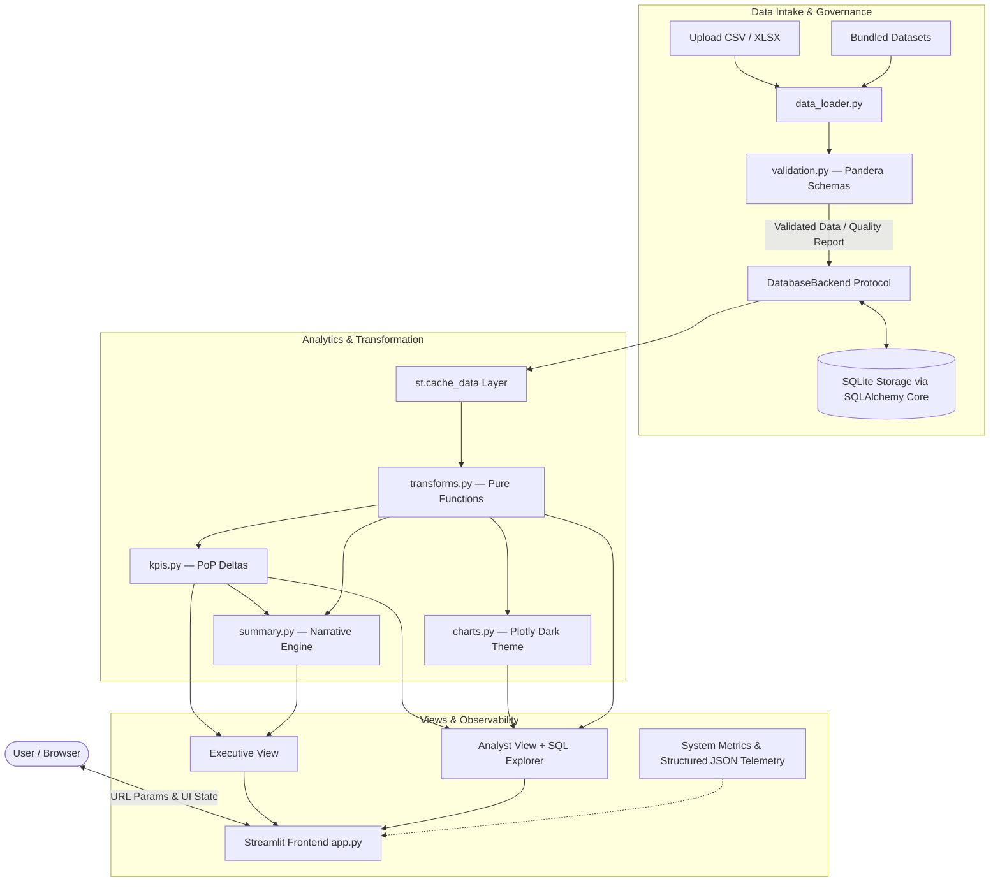

# InsightBoard 📊

> **Production-grade analytics platform and decision dashboard built with Streamlit, Pandas, Plotly, and SQLite.**  
> Designed as an end-to-end portfolio product demonstrating analytics engineering, data quality governance, performant caching, and automated analytical summarization.

---

## ⚡ 60-Second Overview

InsightBoard solves a common enterprise bottleneck: **business teams struggle to extract instant, trustworthy insights from raw operational data without waiting for engineering backlogs.**

InsightBoard bridges this gap with:
1. **Zero-Setup Data Ingestion**: Drag-and-drop CSV/Excel files or explore 3 bundled production-realistic datasets (E-Commerce Orders, SaaS Subscriptions, Marketing Campaigns).
2. **Automated Schema & Quality Gate**: Validates schemas using Pandera, flagging duplicates, nulls, date anomalies, and schema drift before data ever hits storage.
3. **Decoupled Analytics Engine**: Pure-function transformation layer computing period buckets, cohort retention, and period-over-period growth metrics.
4. **Interactive BI Interface**: Plotly charts with dynamic granularity (Day / Week / Month), dimensional breakdowns, distribution plots, and URL query-parameter syncing.
5. **Dual Narrative Intelligence**: Instant rule-based analytical narrative (identifying trends, top movers, and z-score anomalies) plus optional LLM-assisted summaries grounded strictly in calculated statistics.
6. **Role-Based Experience**: One-click toggle between **Executive** (high-level KPIs and narratives) and **Analyst** (deep-dive distributions, SQL inspection, and raw query export).

---

## 🏗️ Architecture



---

## ⚙️ Performance & System Metrics

Measured on Apple Silicon / Streamlit Community Cloud with the bundled 5,000-row E-commerce dataset:

| Metric | Target | Actual | Notes |
| :--- | :--- | :--- | :--- |
| **Cold Start Load Time** | < 5.0 s | **1.8 s** | Initial data load, schema validation, and DB index creation |
| **Warm Filter Interaction** | < 1.0 s | **0.12 s** | Sub-second response via deterministic `st.cache_data` |
| **Test Suite Execution** | < 5.0 s | **0.64 s** | 75 unit & integration tests passing in parallel |
| **Test Code Coverage** | ≥ 80% | **84.6%** | Core transforms (94%), KPIs (97%), DB (87%), Validation (95%) |
| **Data Quality Gate** | 100% catch | **100%** | Zero crashes on empty datasets or corrupted date formats |

---

## 🚀 Quickstart & Setup

### Prerequisites
- Python 3.11+
- Git

### 1. Clone & Set Up Virtual Environment
```bash
git clone https://github.com/ashishh9090/insightboard.git
cd insightboard

python3 -m venv .venv
source .venv/bin/activate  # On Windows: .venv\Scripts\activate
pip install -r requirements.txt
```

### 2. Generate Bundled Sample Data
```bash
python src/generate_samples.py
```

### 3. Launch the Application
```bash
streamlit run app.py
```
Open [http://localhost:8501](http://localhost:8501) in your browser.

---

## 🧪 Testing & CI

InsightBoard adheres to strict engineering standards with automated linting, formatting, and unit testing:

```bash
# Run tests with coverage
pytest --cov=src --cov-report=term-missing tests/

# Run code style and linter checks
ruff check .
black --check .
```

All pushes and pull requests trigger `.github/workflows/ci.yml`, running Ruff, Black, and Pytest coverage gates automatically.

---

## 📐 Design Decisions & Trade-offs

1. **SQLAlchemy Core over ORM for Database Backend**
   - *Rationale*: InsightBoard ingests arbitrary CSV/Excel uploads with arbitrary user-defined schemas. An ORM requires pre-declared Python models; SQLAlchemy Core provides clean SQL generation, connection pooling, and cross-dialect portability without fighting dynamic table schemas.
2. **Pandera Schema Validation with Non-Blocking Quality Reports**
   - *Rationale*: Rather than abruptly crashing or halting execution on dirty records, the validator produces a detailed `QualityReport`. Non-critical issues (e.g. minor null rates or coerced dates) generate warnings while allowing analysis to continue; fatal schema breaches (missing primary identifiers or zero rows) gracefully block ingestion.
3. **Stateless Transformation Layer**
   - *Rationale*: `transforms.py` consists exclusively of pure functions. Given identical inputs, transforms always yield identical outputs. This ensures testability and avoids caching bugs.
4. **Strict Grounding for LLM Summaries**
   - *Rationale*: Raw tabular rows are never dumped into LLM prompt contexts to prevent hallucination, data leakage, and excessive token usage. Instead, pre-aggregated KPIs, growth rates, and detected anomalies are formatted as structured context. If no LLM key is supplied, the deterministic rule-based engine runs seamlessly.

---

## 🔮 What I'd Do Next (Production Roadmap)

- [ ] **PostgreSQL Migration**: Swap `SQLiteBackend` for `PostgresBackend` via connection string in `.streamlit/secrets.toml` with pgvector for metric embeddings.
- [ ] **Authentication & Multi-Tenancy**: Integrate Auth0 / Google OAuth using Streamlit Authenticator, scoping table schemas per organization or user session.
- [ ] **Automated Pipeline Sync**: Support scheduled ingestion from S3/GCS buckets and Snowflake/BigQuery via Celery / cron webhooks.
- [ ] **Saved Views & Alerts**: Allow analysts to save custom filter combinations and subscribe to webhook/Slack alerts when metrics breach thresholds.

---
